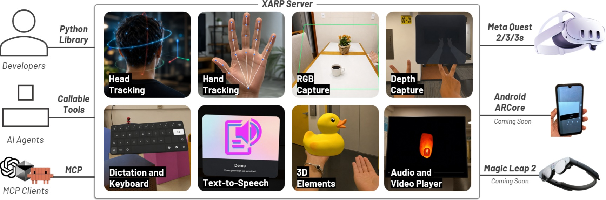

<style>
  #content a.xarp-reference::after {
    content: none;
  }
</style>



<iframe width="560" height="315" src="https://www.youtube.com/embed/q6Yi6uUa7Yw?si=hKIKC0fnNz78VGvg" title="YouTube video player" frameborder="0" allow="accelerometer; autoplay; clipboard-write; encrypted-media; gyroscope; picture-in-picture; web-share" referrerpolicy="strict-origin-when-cross-origin" allowfullscreen></iframe>

XARP is an open-source Python toolkit for building extended reality applications with AI agents. It brings XR and AI development into the same Python workflow and exposes XR capabilities to agents through the Model Context Protocol (MCP).

<a class="xarp-reference" href="https://github.com/hal-ucsb/xarp">GitHub repository</a>

<a class="xarp-reference" href="https://doi.org/10.1145/3816762">Publisher</a>

## Awards

- <a class="xarp-reference" href="https://doi.org/10.1145/3816762">EICS 2026 Honorable Mention Award</a>
- <a class="xarp-reference" href="https://www.cs.ucsb.edu/happenings/awards/2026-computer-science-department-and-campus-awards">UCSB Computer Science 2026 Outstanding Publication of the Year Award</a>

#### BibTeX

```latex
@article{10.1145/3816762,
author = {Caetano, Arthur and Kumaran, Radha and Jou, Kelvin and H{\"o}llerer, Tobias and Sra, Misha},
title = {XARP: A Human-First and Agent-Ready Extended Reality Toolkit in Python},
year = {2026},
issue_date = {June 2026},
publisher = {Association for Computing Machinery},
address = {New York, NY, USA},
volume = {10},
number = {4},
url = {https://doi.org/10.1145/3816762},
doi = {10.1145/3816762},
journal = {Proc. ACM Hum.-Comput. Interact.},
month = jun,
articleno = {EICS010},
numpages = {33},
keywords = {Toolkit, XR, Python, AI, Agents, Model Context Protocol}
}
```

<iframe src="https://arxiv.org/pdf/2508.04108" title="XARP paper PDF" width="100%" height="1200" loading="lazy"></iframe>
